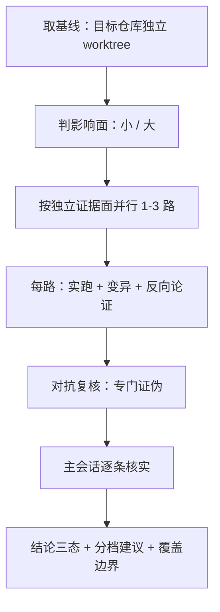

# AI 代码审查：把结论逼到可证伪

> 一句话：让 AI 审代码，难点不在于它能不能读懂，而在于它**很擅长给你一堆听起来都对、却没人验证过的意见**。下面这套做法的全部目的，是把每一条结论逼到“能被实跑推翻”的程度——推不翻的才进报告。

## 先给直觉

普通的“让 AI 审一下这个 PR”，等于请一位没到过现场的专家凭印象写评审意见：说得通、读着顺，但你不知道哪句是真的。我们的做法是把两件事补上：

- **给它工作台**——在目标仓库自己的 worktree 里干活，读那个仓库自己的规范，需要动手就写临时测试真跑起来；
- **找人拆台**——另派一个 agent 专门证伪前面所有结论，它唯一被允许的结论是“我找到了反例”或“我无法证伪”。

比喻：不是请专家看图纸，是**让他把零件装一遍，再找个人试着把它拆坏**。

## 两条判据决定投入多少

- **影响面 → 决定深度**（要不要上严格档：每条结论实跑、反向论证、追全部调用点、点明不可逆部分、加一轮对抗复核）；
- **证据面 → 决定宽度**（并行几路 agent）。

影响面大的清单，命中任一即是：资金 / 余额路径；共识、分叉高度、状态根；签名与随机数、密钥推导；网络准入；不可逆的持久化格式与序列化兼容；公开 API；并发与生命周期。

**不能用行数当风险代理**：4 行的版本比较短路能决定全网准入，一行分叉高度常量能决定分叉；反过来，批量重命名几百行可能影响为零。

| 影响面 | 独立证据面 | 动作 |
|---|---|---|
| 小 | 1 类 | 1 个 agent，常规要求 |
| 大 | 1 类 | 1 个 agent + 严格档 + 一轮对抗复核 |
| 小 | 2+ 类 | 1-2 个，按证据面分 |
| 大 | 2+ 类 | 2-3 个，按证据面分 + 对抗复核 |

**每多一路必须指向一个独立证据面**（读不同文件、用不同手段）：代码正确性 / 实跑行为 / 测试是否真钉住 / 配置与部署耦合 / 历史与上游比对。两路落在同一批文件、同一批证据上，那是同源复述，不算独立验证，也不能当置信度加成。

## 几个真正起作用的硬动作

**1. 关键判断必须实跑，不许只读代码推测。** 写临时测试探针、跑真实执行路径，给出命令与原始输出。确认“被拒的交易仍会进块、回执里没有创世 KV”这种事，靠的是真跑一遍完整执行链，不是读代码读出来的。

**2. 用变异测试判“测试有没有拦截力”。** 把这次修复的关键一步改坏，再跑原有测试：**如果照样全绿，那条测试对本次改动就是没有拦截力的**——必须报。这轮真抓到一条：新增的框架守卫把执行器自己的高度校验遮住了，原本钉住它的用例从此刻起形同虚设，怎么跑都不会红。这类问题 CI 永远发现不了，只有变异能。

**3. 对抗复核是独立的一轮，不是再读一遍代码。** 挑最强的一条结论去攻击，给反例或明说无法证伪。这轮把前面三路里**三条看起来很扎实的结论**推翻了——其中还包括两路互相矛盾时到底哪一对。

**4. 每条结论要能说出“假设它错了，具体怎么坏”。** 不是“这里可能有问题”，而是“什么输入 → 什么错误结果”。说不出来的，通常就是没验证。

**5. 盯住注释与 PR 描述里的陈述性论断。** 因果、执行顺序、覆盖面这类断言要逐条对回实现。真实命中两例：描述说某个函数返回 `"Genesis"`，实测返回的是小写 `"genesis"`；描述说被拒交易“不产生任何 KV / log”，实测必有手续费 KV 和一条错误 log。代码是对的，错的是描述——而后来者会照着错的描述去改代码。

**6. 核对作者的影响面声明。** 声明的和 diff 里做的是否一致：声称“运维需要做 X”而 diff 里没有 X，或者动了运维可见的东西却声明 `none`，都算缺声明。

## 报告怎么写

- **先讲原缺陷是什么**（具体行为 + 后果），再讲怎么改。只罗列“从 A 改成 B”等于没说。
- **缺陷按严重度排**，每条附文件行号与实锤证据。
- **架构建议与质量建议分开成档**：值得现在改 / 可延后 / 不建议改；已经够好的明确写“无需改”。
- **最后给结论三态**：可合 / 需改 / 不可合，并说清必须再改什么。
- **覆盖边界原样转达**：哪些没审、哪些没实跑（例如“外部仓库的执行器没跑，只能按接口约定推断”）。
- **不替人贴评论**：贴不贴、通过还是要求改，由人决定。

## 值不值

一次影响面大的 review：并行 3 路加 1 路对抗，十几分钟、几十万 token 量级。普通改动 1 路就够。花在共识与资金路径上很值——那里漏掉一个边界就是一次分叉。

## 一条诚实的经验

AI 会自信地编。这轮 review 里被推翻的不只是若干“看起来很扎实”的结论，也包括我自己犯的错：把已经回复过的评审意见当成还没回，差点重复回一遍。所以这套规则的落点不是“让 AI 更聪明”，而是**让错误结论在递到你手上之前先死掉**——实跑、变异、反证，三道都在干这件事。
